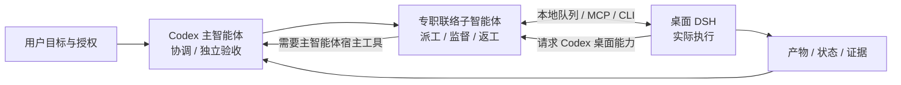

# Codex-DSH-Bridge

[](https://github.com/G0aT-Shen/Codex-DSH-Bridge/actions/workflows/ci.yml)

让 Codex 负责项目协调与独立审核，让专职子智能体持续联络桌面 DeepSeek Harness（DSH），由 DSH 实际执行任务。桥接提供任务队列、预算、实时进度、结构化交付、证据、返工、验收依赖，以及 DSH 向 Codex 请求桌面能力的反向通道。

仓库：[G0aT-Shen/Codex-DSH-Bridge](https://github.com/G0aT-Shen/Codex-DSH-Bridge)。本项目使用 MIT 许可证。

通过 Git 源码与本地插件链接分发，不发布 npm 包；`private:true` 用于防止误发布。用户操作说明主要为中文，任务可明确要求其他交付语言。



监督依赖当前活动的 Codex 任务。队列不会自行唤醒已结束的 Codex 回合；能力回包也不会自动续跑已结束的 DSH 原生会话。`terminal:true`、`completed` 与主审 `accepted` 是不同状态。

## 快速开始

前提：Node.js 22 或更新版本、Git、已安装并能正常执行模型任务的桌面 DSH，以及 Codex。提供 macOS 与 Windows 原生 PC 的安装路径；历史桌面联动主要在 macOS 验证，Windows 的真实 DSH 客户端仍须在你的 PC 验收。CI 的源码/安装器测试不等于桌面应用已经跑通。

### macOS

```sh
git clone https://github.com/G0aT-Shen/Codex-DSH-Bridge.git
cd Codex-DSH-Bridge
node --version
npm ci --ignore-scripts
npm test
```

通过 DSH 的插件管理方式确保桌面 profile 中可解析 `@deepseek-ai/dsh-skill-filesystem` 和 `@deepseek-ai/dsh-hmr`。只有需要镜像外部 MCP 时，才需要 `@deepseek-ai/dsh-mcp-client`。安装器会使用本地源码链接安装本仓库的主桥与共享插件，不执行网络依赖安装。

先让活动任务收尾，退出 DSH，再查看变更并安装两套 Codex 技能和桌面插件：

```sh
node scripts/install-skills.mjs --dry-run
node scripts/install-skills.mjs
node scripts/install-shared.mjs --dry-run
node scripts/install-shared.mjs
codex mcp add dsh-bridge -- node "$PWD/mcp.mjs"
```

默认 DSH profile 是 `~/.dsh/profiles/desktop`；默认技能目录是 `$CODEX_HOME/skills`，未设置时使用 `~/.codex/skills`。其他 profile、Codex CLI 路径、队列目录及可选 LMS 配置见[部署说明](docs/deployment.md)。保持克隆目录位置不变，本地插件和已安装技能会引用它。

重新打开桌面 DSH，检查当前运行状态：

```sh
node cli.mjs health --json
node cli.mjs shared-status --json
node scripts/verify-shared.mjs
```

### Windows PC / PowerShell

在 Windows 安装 Node.js ≥22、Git、Codex 和适用于该 PC 的桌面 DSH；先打开 DSH 完成模型及工具配置，并通过其插件管理方式准备上面列出的宿主插件，再退出 DSH。下面使用 Windows 原生路径，不需要 WSL：

```powershell
git clone https://github.com/G0aT-Shen/Codex-DSH-Bridge.git
Set-Location Codex-DSH-Bridge
$BridgeRepo = (Get-Location).Path
$DshProfile = Join-Path $env:USERPROFILE ".dsh\profiles\desktop"
$CodexCli = Join-Path $env:APPDATA "npm\codex.cmd"
node --version
npm.cmd ci --ignore-scripts
npm.cmd test
node scripts/install-skills.mjs --dry-run
node scripts/install-skills.mjs
node scripts/install-shared.mjs --profile "$DshProfile" --dry-run
node scripts/install-shared.mjs --profile "$DshProfile"
& $CodexCli mcp add dsh-bridge -- node "$BridgeRepo\mcp.mjs"
```

`$DshProfile` 必须指向你的实际桌面 profile 目录；如果 DSH 使用其他位置，改成其绝对路径。`$CodexCli` 示例适用于标准 npm 安装的 `codex.cmd`；原生安装改成真实 `codex.exe` 路径。安装器使用 Windows junction 连接源码目录，不依赖管理员创建符号链接的权限。中文和空格路径需保留引号。

队列依赖硬链接，请使用支持硬链接的本地 NTFS 目录；FAT/exFAT 或部分网络盘不适用。将 profile 和队列放在私人用户目录并使用正确的 NTFS 权限；代码中的 `0600/0700` 不等于 Windows ACL 保护。PowerShell 5.1 的 JSON 回包建议使用 UTF-8 文件与 `--file`，见[协议示例](docs/protocol.md)。

重新打开对应桌面 DSH，在该仓库目录运行：

```powershell
node cli.mjs health --json
node cli.mjs shared-status --json
node scripts/verify-shared.mjs
```

### 开始协作

主桥应返回 `alive:true`、`version:2`；共享服务有自己的版本，不要求它也是 `2`。`verify-shared` 是对当前宿主的只读核查，不调用模型、不安装插件，也不依赖历史报告。重新连接 MCP 并新开 Codex 聊天，让当前技能和工具表生效；缓存旧工具表时可以先使用 CLI。

安装完成后，在活动的 Codex 聊天中使用：

> 使用 dsh-orchestrator，把这个项目交给桌面 DSH。你做项目协调员和独立审核员，派一名子智能体持续联络 DSH。先明确工作目录、目标、授权、写入范围和验收标准；遇到反向桌面请求由你们处理；主审验证通过后再放行后续任务。

Codex 需具备子智能体工具且当前会话允许派工。没有这类工具时，由主智能体承担同样的持续监督，并如实说明执行方式。安装技能文件本身不会创建子智能体。

## 提供什么

- 桌面会话中的执行队列，最多四个并发槽位；通过预算与收尾提醒控制每次尝试。
- `watch` / `bridge_wait` 阻塞等待、`steer` 中途纠偏、`answer` 问答续跑，以及优先复用会话的 `repair`。
- `digest` 汇总执行者交付和 worker 采集证据；主智能体另行核验真实文件并运行决定正确性的检查。
- `dependsOn` 与默认 `dependencyPolicy:accepted`，让下游等待主审验收。
- 公开文本和工具操作的增量读取、带 revision 的显式共享笔记，以及 Codex 专属能力请求与回包。
- 20 个 Codex MCP 工具和完整 CLI；LMS 等可移植 stdio MCP 是可选集成。

## 必须理解的边界

`writeScope` 是应用层工具守卫，覆盖已识别的文件工具和常见 shell 写入目标；它不是完整的操作系统沙箱，也不能可靠阻止任意解释器或复杂命令的副作用。未声明或设置 `writeScope:[]` 都不启用路径守卫。`authorization` 主要进入执行提示词，不是完整的系统权限控制。请结合 DSH 自身的审批、工具权限与运行环境设置边界。

审查包中 `evidence.commands[].exitCode` 可能是 `null`，Markdown 的 `ok` 不能替代真实退出码和主审独立复现。文件证据也只覆盖 worker 能识别的触碰记录，不能作为所有副作用的完整清单。

原生 DSH 会话的反向请求可能 `jobId:null`。可以按用户授权回包、读取该会话的公开状态，但不能套用 job 的 `watch`、`digest` 或 `repair`。`respond` 成功表示结果已保存，不表示 DSH 已消费或恢复执行。

## 文档与来源

| 文档 | 内容 |
| --- | --- |
| [部署](docs/deployment.md) | 依赖、安装参数、验证、更新与回退 |
| [协作流程](docs/workflow.md) | 主协调审核 → 子智能体联络 ↔ 桌面 DSH 执行 |
| [协议与命令](docs/protocol.md) | 配置、预算、DAG、状态、20 个 MCP 工具和 CLI |
| [排障](docs/troubleshooting.md) | 离线、等待、晚到请求、证据缺口与宿主限制 |
| [架构与验证](docs/architecture.md) | 模块职责、数据流、跨平台测试与真机验收边界 |
| [DSH 接口研究](docs/research/dsh-interfaces.md) | 桌面插件、技能、MCP、公开事件及 profile 的静态观察 |
| [DSH 宿主研究](docs/research/dsh-host-findings.md) | 对所检查发行版本的范围、来源与限制 |
| [Codex 宿主研究](docs/research/codex-host-findings.md) | 本地协议与宿主能力复用的已知边界 |

研究文档描述特定已检查发行版本的静态观察；其中提到的本地提取清单和原始制品不随本仓库发布。不要把静态接口存在解释成当前宿主运行验证。实现入口为 [`boot.js`](boot.js)、[`worker.js`](worker.js)、[`protocol.js`](protocol.js)、[`cli.mjs`](cli.mjs)、[`mcp.mjs`](mcp.mjs) 和 [`shared-plugin/boot.js`](shared-plugin/boot.js)。

仓库发布源码、部署脚本、技能、示例、测试和研究说明。运行时队列、个人笔记、原生会话日志、课程资料与认证信息应留在使用者的本机，不要提交到仓库。

[GitHub Actions](https://github.com/G0aT-Shen/Codex-DSH-Bridge/actions) 配置 Linux、macOS、Windows 与 Node.js 22/24 的隔离测试；查看具体提交的实际运行结果。CI 使用模拟 DSH 宿主，不启动桌面应用或调用模型。
